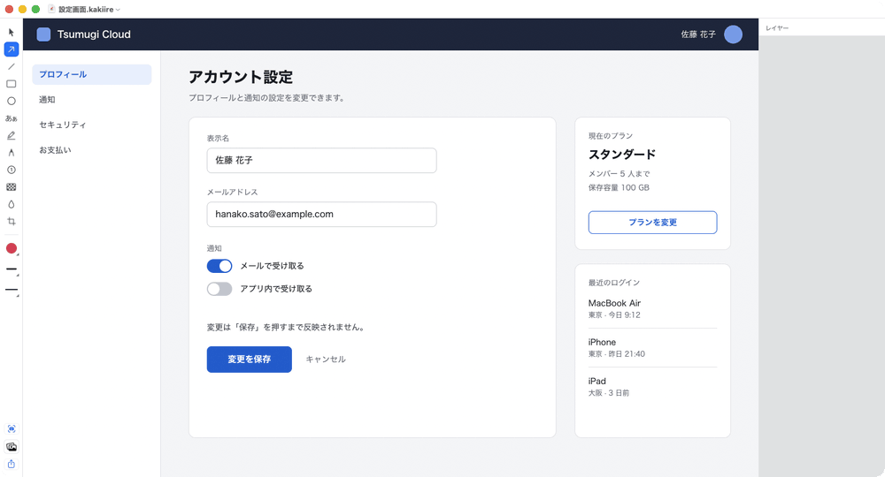
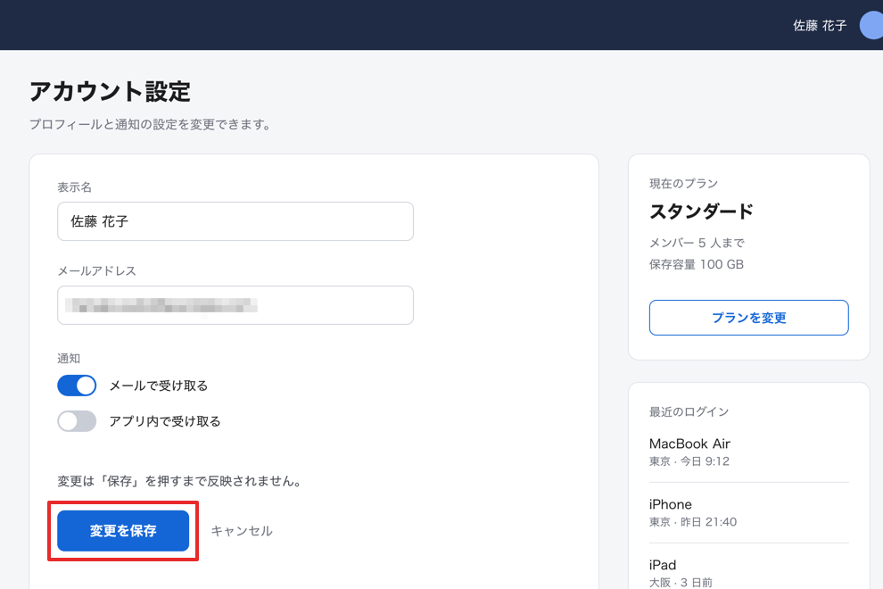

<p align="center">
  
</p>

<h1 align="center">Kakiire(書き入れ)</h1>

<p align="center">
  スクショに矢印・枠・文字を書き入れ、モザイクで隠せる Mac アプリ。<br>
  注釈はレイヤーのまま保存して、あとから直せる。<br>
  CLI と MCP サーバーも付いていて、Claude Code などの AI からも注釈を付けられる。
</p>

<p align="center">
  <a href="https://kakiire.tep-lab.com/">Web サイト</a> ·
  <a href="https://github.com/sumihiro3/kakiire/releases/latest">ダウンロード</a> ·
  <a href="README.md">English</a> ·
  <a href="docs/cli.md">CLI / MCP</a>
</p>

<p align="center">
  
  
  
  <a href="LICENSE"></a>
  <a href="https://github.com/sumihiro3/kakiire/actions/workflows/ci.yml"></a>
</p>

<p align="center">
  
</p>

## 3つの使い方

| | 使い方 | こんなとき |
|---|---|---|
| **アプリ** | 撮って、手で書き入れる | 手順書や不具合の報告に、スクショを1枚ずつ仕上げる |
| **CLI** `kakiire annotate` | JSON で注釈を渡して書き出す | スクリプトでまとめて枠やモザイクを入れる |
| **MCP** `kakiire mcp` | AI に頼んで書き入れてもらう | 「保存ボタンを赤枠で囲んで、メールアドレスは隠して」と言葉で頼む |

どれも描画は同じなので、見た目は変わりません。CLI や AI が書いた注釈も `.kakiire` で書き出せば、アプリで開いて手で直せます。

> `~/Desktop/shot.png` の「保存」ボタンを赤枠で囲んで、メールアドレスにモザイクをかけて、`~/Desktop/shot-annotated.png` に書き出して

<p align="center">
  
</p>

## なぜ作ったか

長く使われてきた Skitch は Intel 版しかなく、Rosetta がなくなると動かなくなります。代わりのアプリの多くは「書き出したら終わり」で、矢印を少しずらしたいだけでも最初から描き直しになります。

Kakiire は Apple Silicon で動くネイティブアプリです。注釈を消さずに元ファイル(`.kakiire`)に残すので、あとから1つずつ直せます。Photoshop の PSD と PNG のように、手元には直せる元ファイルを残し、人に渡すのは画像にします。

## 特徴

### 書き入れる
- 矢印(先細りの Skitch 風)・線・矩形・楕円
- 矢印には白い縁取りを付けられる
- 線は実線・破線・点線・一点鎖線から選べる
- テキスト(大きさは9段階、袋文字)、ハイライター(下の文字が透ける)、ペン
- テキストは四隅のつまみをドラッグして、好きな大きさにもできる
- 番号スタンプ(1, 2, 3… / A, B, C… と自動で進む)
- スタンプには記号や絵文字も使える
- 別の画像を貼って重ねる(枠線と影を付けられる)
- 道具はキー1つで切り替える
- Shift を押しながら描くと、45° 刻み・正方形・正円になる
- 複数の注釈を揃えたり、等間隔に並べたりできる
- グリッドも表示できる

### 隠す
- モザイクとぼかし(強さは3段階)
- 書き出した PNG には、モザイクをかける前の画像も、位置情報などのメタデータも残らない

### あとから直す
- `.kakiire` 形式で保存すると、すべての注釈をあとから動かしたり、色を変えたり、消したりできる
- レイヤーパネルで並べ替え、表示の切り替え、ロック、名前の変更ができる
- 回転・反転・切り抜き・画像サイズの変更も元に戻せる
- 自動保存と版の履歴に対応
- Finder ではサムネイルが出て、スペースキーでプレビューできる(Quick Look)

### 撮る
- ⌃⇧⌘5 で、ほかのアプリを使っているときでも範囲を選んで撮れる
- メニューバーに常駐する
- ウインドウを全部閉じても終了しない

### AI から使う
- CLI `kakiire` で、画像に注釈を付けて PNG / JPEG / `.kakiire` に書き出せる
- `kakiire mcp` が MCP サーバーとして動く
- ローカルで動くので、画像を外に送らない

### そのほか
- 外部ライブラリなし、完全オフライン、テレメトリなし
- 日本語・英語

## 動作環境

- macOS 15 以降
- Apple Silicon

## インストール

<!-- TODO: Developer ID 署名・公証済みの DMG を用意したら書き換える(docs/handoff.md フェーズ5) -->

[Releases](https://github.com/sumihiro3/kakiire/releases/latest) から最新の版をダウンロードし、`Kakiire.app` をアプリケーションフォルダに入れてください。

<!-- TODO: Homebrew の cask を用意したら足す
```bash
brew install --cask kakiire
```
-->

CLI(`kakiire`)はアプリとは別に配ります。今はソースからビルドします([CLI と MCP サーバー](docs/cli.md#インストール))。

## 使い方

1. 次のどれかで始める
   - スクリーンショットを撮る(⌃⇧⌘5、またはメニューバーのアイコンから)
   - クリップボードの画像から(⇧⌘N)
   - 画像ファイルを開く(⌘O)・ドロップする
2. 道具を選んで書き入れる
3. 書き出す(⇧⌘E)、画像をコピーする(⇧⌘C)、またはウインドウからドラッグして持ち出す
4. あとで直したいときは `.kakiire` で保存する(⌘S)

### 道具のキー

| キー | 道具 | キー | 道具 |
|---|---|---|---|
| `V` | 選択 | `H` | ハイライター |
| `A` | 矢印 | `P` | ペン |
| `L` | 線 | `N` | スタンプ |
| `R` | 矩形 | `M` | モザイク |
| `O` | 楕円 | `B` | ぼかし |
| `T` | テキスト | `C` | 切り抜き |

### よく使うショートカット

| キー | すること |
|---|---|
| ⌃⇧⌘5 | スクリーンショットを撮る(設定で変えられる) |
| ⇧⌘E | 書き出す(PNG / JPEG) |
| ⇧⌘C | 画像をコピーする |
| ⇧⌘I | ファイルから画像を挿入する |
| ⌘K / ⌥⌘K | 切り抜く / 切り抜きの範囲を px で指定する |
| ⌥⌘I | 画像サイズを変える |
| ⌥⌘+ / ⌥⌘- | 文字を大きく / 小さく |
| ⌘9 / ⌘0 | ウインドウに合わせる / 実寸 |
| ⌘' | グリッドを表示する |

## AI から使う(CLI / MCP)

CLI を入れたら、Claude Code に MCP サーバーとして登録します。

```bash
claude mcp add kakiire -- ~/.local/bin/kakiire mcp
```

あとは言葉で頼むだけです。AI は `get_image_info` で画像の大きさと中身を確かめてから、`annotate_image` で注釈を付けます。

CLI だけでも使えます。

```bash
kakiire info shot.png
kakiire annotate shot.png -o shot-annotated.png -o shot.kakiire -a notes.json
kakiire export shot.kakiire -o shot.png --scale 0.5
```

注釈の JSON の形、MCP のツール、Claude Desktop での設定は [docs/cli.md](docs/cli.md) にあります。

## `.kakiire` 形式

中身は zip です。注釈を書いた `document.json`、元画像、Quick Look 用の `preview.png` が入っています。Kakiire がなくても中身を取り出せるので、注釈ごと閉じ込められる心配はありません。Google ドライブなどで共有しても壊れない単一ファイルです。

## ソースからビルドする

必要なもの:Xcode 26 以降、[XcodeGen](https://github.com/yonaskolb/XcodeGen)

```bash
swift test
```

```bash
xcodegen generate
```

```bash
xcodebuild -project Kakiire.xcodeproj -scheme Kakiire -configuration Debug -derivedDataPath build/DerivedData build
```

```bash
open build/DerivedData/Build/Products/Debug/Kakiire.app
```

署名するチームは `project.yml` にあります。自分の Apple ID でビルドするときは、そこを書き換えるか、ad-hoc 署名(`CODE_SIGN_IDENTITY=- DEVELOPMENT_TEAM=`)でビルドしてください。ad-hoc 署名だと、ビルドするたびに画面収録の許可が外れます。

### 構成

| 層 | 場所 | 役目 |
|---|---|---|
| Core | `Sources/KakiireCore` | 文書モデル、編集、描画。AppKit に依存しない |
| IO | `Sources/KakiireIO` | `.kakiire` の読み書き、画像の書き出し |
| Tooling | `Sources/KakiireTooling`・`Sources/kakiire` | CLI と MCP サーバー |
| App | `App/` | AppKit の画面 |
| 拡張 | `Extensions/` | Quick Look(サムネイル・プレビュー) |

設計は [docs/handoff.md](docs/handoff.md)、方針の記録は [docs/adr/](docs/adr/) にあります。

## コントリビュート

Issue や Pull Request を歓迎します。PR の本文には「## 変更履歴」の欄を置き、使う人から見える変化を書いてください(載せる変化がなければ「なし」)。版を上げるときに [CHANGELOG.md](CHANGELOG.md) へ写します。

## ライセンス

[MIT License](LICENSE)

矢印・モザイクなどのコードの一部は [Sitch](https://github.com/phalladar/Sitch)(MIT)から流用しています。詳しくは [THIRD_PARTY_NOTICES.md](THIRD_PARTY_NOTICES.md) を見てください。

© TEP-Lab
