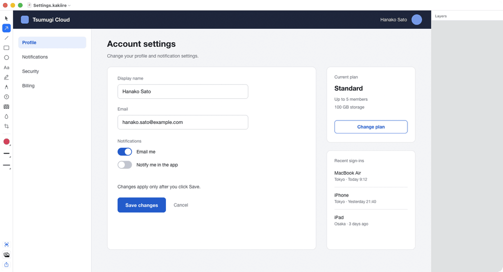
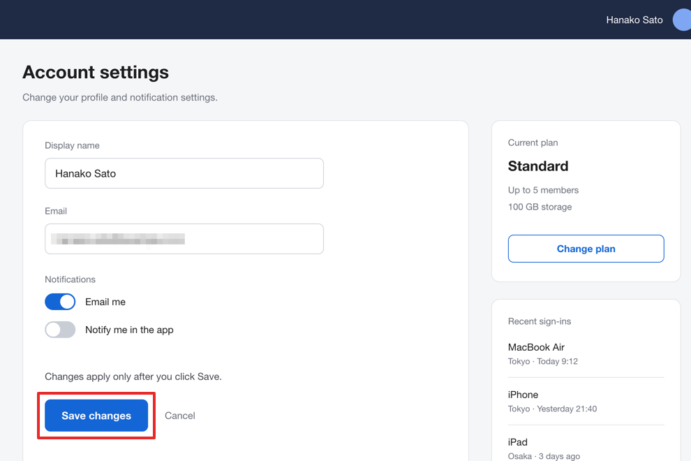

<p align="center">
  
</p>

<h1 align="center">Kakiire</h1>

<p align="center">
  A Mac app for marking up screenshots with arrows, boxes and text, and hiding details with mosaic.<br>
  Annotations stay as layers, so you can fix them later.<br>
  It also ships a CLI and an MCP server, so AI agents like Claude Code can annotate images too.
</p>

<p align="center">
  <a href="https://kakiire.tep-lab.com/en/">Website</a> ·
  <a href="https://github.com/sumihiro3/kakiire/releases/latest">Download</a> ·
  <a href="README.ja.md">日本語</a> ·
  <a href="docs/cli.md">CLI / MCP (Japanese)</a>
</p>

<p align="center">
  
  
  
  <a href="LICENSE"></a>
  <a href="https://github.com/sumihiro3/kakiire/actions/workflows/ci.yml"></a>
</p>

<p align="center">
  
</p>

*Kakiire* (書き入れ) is Japanese for "writing in" — writing notes into a picture.

## Three ways to use it

| | How | When |
|---|---|---|
| **App** | Capture and annotate by hand | Polishing screenshots for a how-to or a bug report |
| **CLI** `kakiire annotate` | Pass annotations as JSON and export | Adding boxes or mosaics to many images from a script |
| **MCP** `kakiire mcp` | Ask an AI agent in plain words | "Put a red box around the Save button and hide the email address" |

All three draw with the same renderer, so the result looks the same.
Export to `.kakiire` and you can open what the CLI or the AI drew in the app and adjust it by hand.

> Put a red box around the Save button in `~/Desktop/shot.png`, pixelate the email address, and write it to `~/Desktop/shot-annotated.png`

<p align="center">
  
</p>

## Why

Skitch, long a favorite, only ships for Intel Macs and will stop working once Rosetta goes away.
Most alternatives are "export and done": to nudge an arrow, you redraw it from scratch.

Kakiire is a native Apple Silicon app.
It keeps your annotations in an editable file (`.kakiire`), so you can fix them one at a time later.
Think PSD and PNG: keep the editable original, hand out the image.

## Features

### Write in
- Arrows (tapered, Skitch-style), lines, rectangles and ellipses
- Arrows can have a white outline
- Lines can be solid, dashed, dotted or dash-dot
- Text (9 size steps, outlined), highlighter (text underneath shows through) and pen
- Drag a text box's corner handles to make it any size
- Numbered stamps (1, 2, 3… / A, B, C… count up automatically)
- Stamps can also be symbols or emoji
- Speech bubbles in four shapes: rounded, ellipse, cloud (thinking) and jagged (shouting). They grow with the text, and you drag the tail to point at something
- Paste another image on top (with an optional border and shadow)
- Switch tools with a single key
- Hold Shift to snap to 45°, squares and circles
- Align selected annotations or space them evenly
- Show a grid

### Hide
- Mosaic and blur (3 strength levels)
- Exported PNGs keep neither the image before the mosaic nor metadata such as location

### Fix it later
- Save as `.kakiire` to move, recolor or delete any annotation later
- Reorder, hide, lock and rename annotations in the layer panel
- Rotate, flip, crop and resize, all undoable
- Autosave and version history
- Thumbnails in Finder and Quick Look preview with the space bar

### Capture
- Press ⌃⇧⌘5 from any app to capture an area
- Lives in the menu bar
- Keeps running after you close every window, so ⌃⇧⌘5 keeps working (quit with ⌘Q or from the menu bar icon)

### Use from AI
- The `kakiire` CLI annotates an image and writes PNG, JPEG or `.kakiire`
- `kakiire mcp` runs as an MCP server
- It runs locally, so your images never leave your Mac

### Use from Shortcuts
- Four actions: capture an area and open it, open an image, export a `.kakiire` as PNG or JPEG, and get the current image
- "Capture Area" and "Current Image" also work from Spotlight and Siri

### Also
- No third-party libraries, fully offline, no telemetry
- English and Japanese

## Requirements

- macOS 15 or later
- Apple Silicon

## Install

Download [Kakiire.dmg](https://github.com/sumihiro3/kakiire/releases/latest/download/Kakiire.dmg) (latest version), open it, and drag `Kakiire.app` to Applications. The app is notarized by Apple, so it opens without warnings.

You can also install it with Homebrew. Homebrew only loads third-party taps you have trusted, so run `brew trust` once first:

```bash
brew trust sumihiro3/tap
brew install --cask sumihiro3/tap/kakiire
```

The CLI and MCP server (`kakiire`) are distributed separately from the app ([details](docs/cli.md#インストール)):

```bash
brew install sumihiro3/tap/kakiire
```

The app and the CLI share the name `kakiire` in the tap, so use the full name when upgrading too:

```bash
brew update && brew upgrade --cask sumihiro3/tap/kakiire && brew upgrade sumihiro3/tap/kakiire
```

## Usage

1. Start in one of these ways
   - Take a screenshot (⌃⇧⌘5, or from the menu bar icon)
   - From an image on the clipboard (⇧⌘N)
   - Open (⌘O) or drop an image file
2. Pick a tool and write in
3. Export (⇧⌘E), copy the image (⇧⌘C), or drag it out of the window
4. To edit later, save as `.kakiire` (⌘S)

### Tool keys

| Key | Tool | Key | Tool |
|---|---|---|---|
| `V` | Select | `H` | Highlighter |
| `A` | Arrow | `P` | Pen |
| `L` | Line | `N` | Stamp |
| `R` | Rectangle | `M` | Mosaic |
| `O` | Ellipse | `B` | Blur |
| `T` | Text | `C` | Crop |
| `S` | Speech bubble | | |

### Shortcuts

| Key | Action |
|---|---|
| ⌃⇧⌘5 | Take a screenshot (configurable in Settings) |
| ⇧⌘E | Export (PNG / JPEG) |
| ⇧⌘C | Copy image |
| ⌘C / ⌘X / ⌘V | Copy / cut / paste the selected annotations (⌘C copies the image when nothing is selected) |
| ⌘D | Duplicate the selected annotations |
| ⇧⌘I | Insert an image from a file |
| ⌘K / ⌥⌘K | Crop / set the crop area in pixels |
| ⌥⌘I | Image size |
| ⌥⌘+ / ⌥⌘- | Bigger / smaller text |
| ⌘9 / ⌘0 | Zoom to fit / actual size |
| ⌃⌘G | Show grid |

## Use from AI (CLI / MCP)

Once the CLI is installed, register it with Claude Code as an MCP server:

```bash
claude mcp add -s user kakiire -- /opt/homebrew/bin/kakiire mcp
```

Then just ask in plain words.
The agent checks the image's size and content with `get_image_info`, then adds annotations with `annotate_image`.

The CLI works on its own, too:

```bash
kakiire info shot.png
kakiire annotate shot.png -o shot-annotated.png -o shot.kakiire -a notes.json
kakiire export shot.kakiire -o shot.png --scale 0.5
```

Coordinates are in image pixels (top-left origin, y down).
A minimal annotation file looks like this:

```json
[
  {"type": "rect", "geometry": {"rect": [120, 120, 500, 400]}, "style": {"color": "#E82A2A", "width": 6}},
  {"type": "obscure", "geometry": {"rect": [700, 80, 250, 40]}, "style": {"mode": "pixelate", "strength": 16}}
]
```

The full annotation format, the MCP tools and the Claude Desktop setup are in [docs/cli.md](docs/cli.md) (Japanese).
The MCP tool descriptions themselves are in English, so agents can use them without the docs.

## The `.kakiire` format

It's a zip file.
Inside are `document.json` (the annotations), the original image and `preview.png` for Quick Look.
You can unpack it without Kakiire, so your annotations are never locked in.
It's a single file, so it survives sharing through Google Drive and the like.

## Build from source

You need Xcode 26 or later and [XcodeGen](https://github.com/yonaskolb/XcodeGen).

```bash
swift test
```

```bash
xcodegen generate
```

```bash
xcodebuild -project Kakiire.xcodeproj -scheme Kakiire -configuration Debug -derivedDataPath build/DerivedData build
```

```bash
open build/DerivedData/Build/Products/Debug/Kakiire.app
```

The signing team is set in `project.yml`.
To build with your own Apple ID, change it there, or build ad-hoc signed (`CODE_SIGN_IDENTITY=- DEVELOPMENT_TEAM=`).
With ad-hoc signing, macOS forgets the Screen Recording permission on every build.

### Layout

| Layer | Path | Role |
|---|---|---|
| Core | `Sources/KakiireCore` | Document model, editing and rendering, with no AppKit dependency |
| IO | `Sources/KakiireIO` | Reading and writing `.kakiire`, image export |
| Tooling | `Sources/KakiireTooling`, `Sources/kakiire` | CLI and MCP server |
| App | `App/` | AppKit UI |
| Extensions | `Extensions/` | Quick Look (thumbnail and preview) |

Design notes ([docs/handoff.md](docs/handoff.md)) and decision records ([docs/adr/](docs/adr/)) are in Japanese.

## Contributing

Issues and pull requests are welcome.
Please add a "## 変更履歴" (changelog) section to the PR description and list the changes users will notice (write "なし" if there are none).
They are copied into [CHANGELOG.md](CHANGELOG.md) when the version is bumped.

## License

[MIT License](LICENSE)

Parts of the arrow and mosaic code are adapted from [Sitch](https://github.com/phalladar/Sitch) (MIT).
See [THIRD_PARTY_NOTICES.md](THIRD_PARTY_NOTICES.md).

© TEP-Lab
