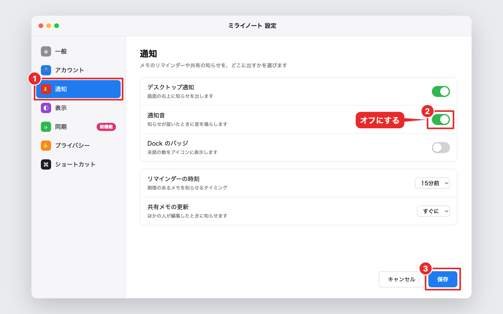
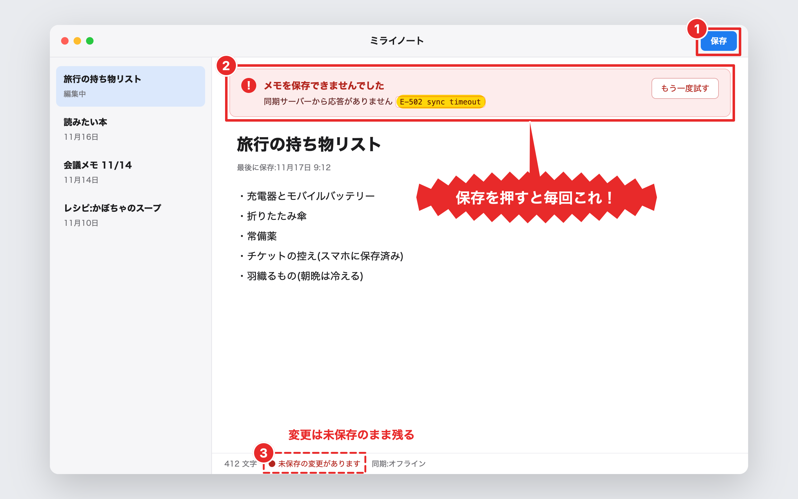
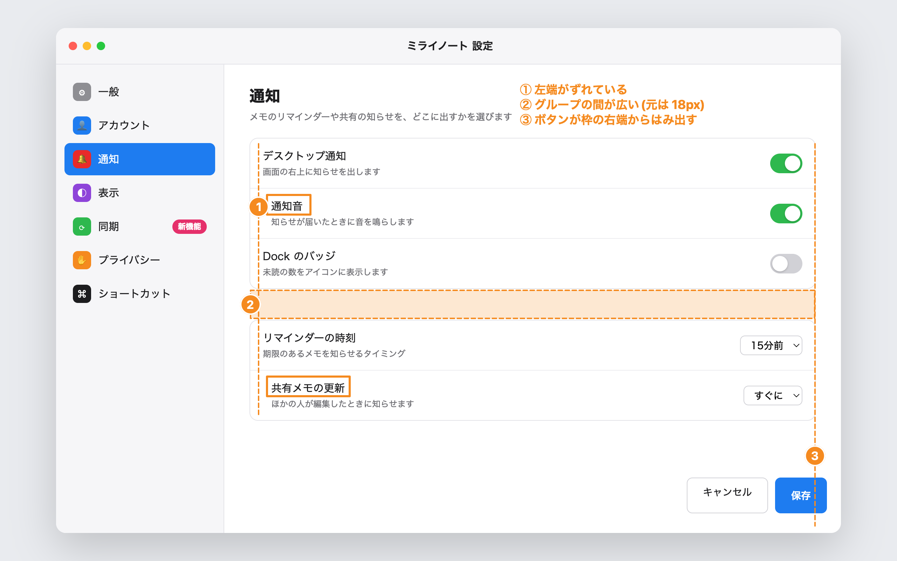
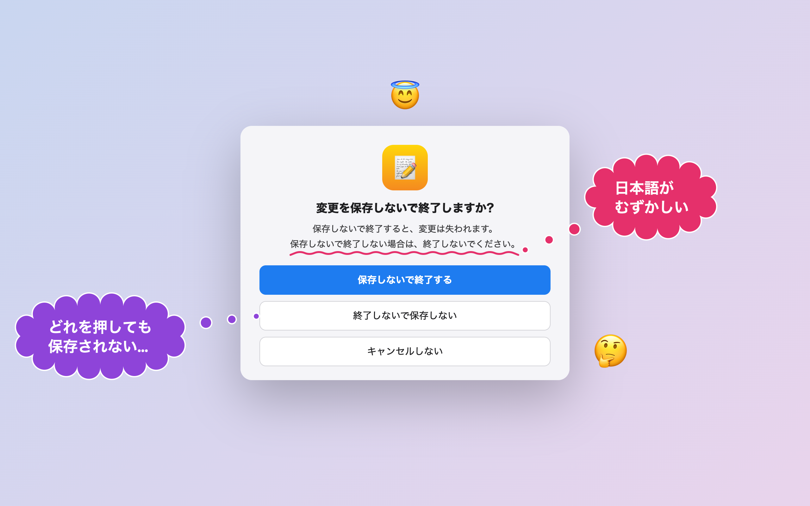
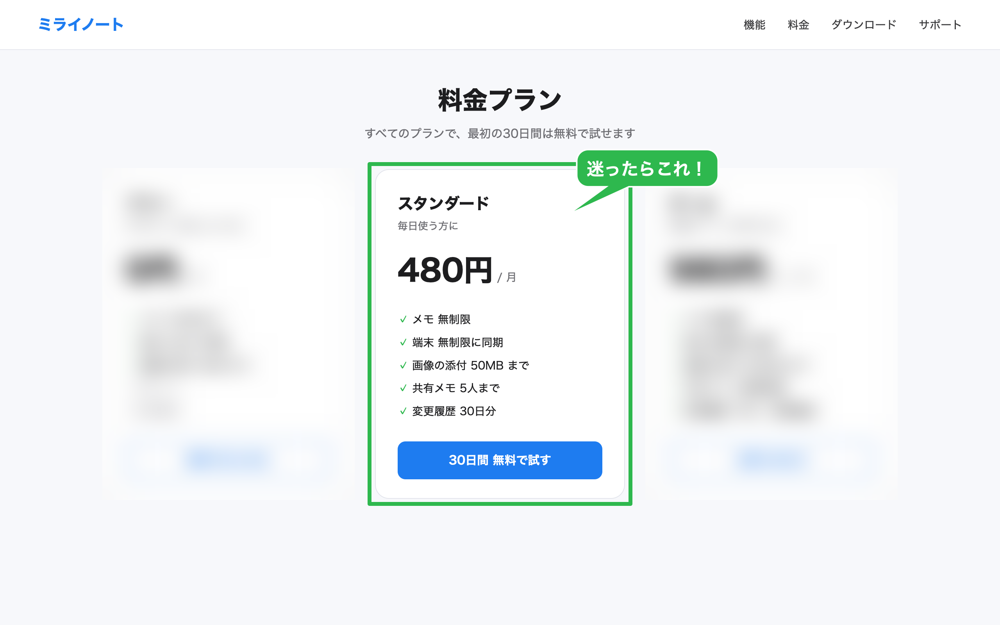
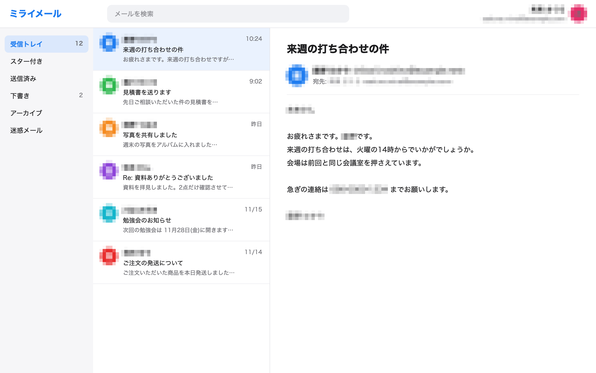

# 使用例

Claude Code などの AI エージェントに、Kakiire の MCP サーバーで画像の注釈を頼んだ例。どれも元の画像・頼んだ文・付けた注釈(JSON)を置いているので、CLI で同じものを作ったり、`.kakiire` をアプリで開いて直したりできる。AI がずれや隠し漏れに気づいて直した所も、それぞれの例に書いている。

元の画面は、どれもこの例のために作った架空のもの([screens/](screens/))。コードの解説だけは Kakiire 本体のコードを使っている。MCP サーバーの入れ方と注釈の形は [docs/cli.md](../cli.md) にある。

| 例 | すること | 主に使うもの |
|---|---|---|
| [設定画面に、操作の手順を番号で書き入れる](settings-steps/README.md) | 押す場所を赤枠で囲み、①②③と吹き出しで手順を示す | `rect`・`stamp`・`bubble` |
| [エラーの画面に、バグ報告の印を付ける](bug-report/README.md) | 再現の順番・エラーコード・その後の状態を書き入れる | `rect`・`highlighter`・`bubble`(叫び) |
| [PR の画面に、レビューの指摘を書き入れる](pr-review/README.md) | 崩れている所を番号・点線の基準線・塗りで示す | `line`・`rect`・`text` |
| [コードの大事な所に、印と説明を書き入れる](code-explain/README.md) | 要になる3行を囲み、一言ずつ説明する(暗い背景) | `rect`(半透明の塗り)・`text` |
| [変なダイアログに、SNS 用のツッコミを入れる](sns-tsukkomi/README.md) | 雲の吹き出し・波線・絵文字でツッコむ | `bubble`(雲)・`pen`・`stamp`(絵文字) |
| [料金表で、おすすめのプランに目を向けさせる](pricing-compare/README.md) | おすすめを枠で囲み、ほかのプランをぼかす | `rect`・`obscure`(ぼかし)・`bubble` |
| [必要な所だけ切り抜いて、新機能を知らせる](settings-crop/README.md) | サイドバーだけ切り抜き、「新機能」を丸と吹き出しで強調する | `crop`・`ellipse`・`bubble` |
| [メール画面の個人情報を、ひと言で隠す](mail-privacy/README.md) | 名前・アドレス・電話番号・名前入りのアイコンの20か所を隠す | `obscure` |
| [フォルダのスクショを、まとめて隠して縮める](mail-batch/README.md) | 3枚から名前・アドレス・電話番号・住所を隠し、半分の大きさで書き出す | `obscure`・`scale` |
| [ニュースサイトのスクショに、まとめてモザイクをかける](news-mosaic/README.md) | 記事の写真・ロゴ・媒体のアイコン・地名など16か所を隠す | `obscure` |

| 手順書 | バグ報告 |
|---|---|
|  |  |
| **PR のレビュー** | **コードの解説** |
|  |  |
| **SNS のツッコミ** | **料金表** |
|  |  |
| **個人情報を隠す** | **ニュースサイトのモザイク** |
|  |  |
