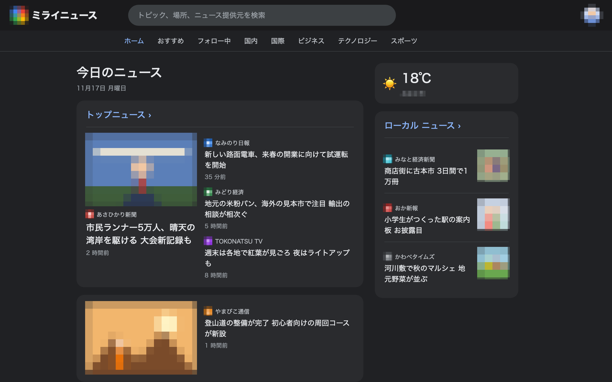

# 使用例

Claude Code などの AI エージェントに、Kakiire の MCP サーバーで画像の注釈を頼んだ例。どれも元の画像・頼んだ文・付けた注釈(JSON)・書き出した `.kakiire` を置いているので、CLI で同じものを作ったり、アプリで開いて直したりできる。

MCP サーバーの入れ方と注釈の形は [docs/cli.md](../cli.md) にある。

| 例 | すること | 使う注釈 |
|---|---|---|
| [ニュースサイトのスクショに、まとめてモザイクをかける](news-mosaic/README.md) | 記事の写真・ロゴ・媒体のアイコン・地名など16か所をひと言で隠す | `obscure` |

