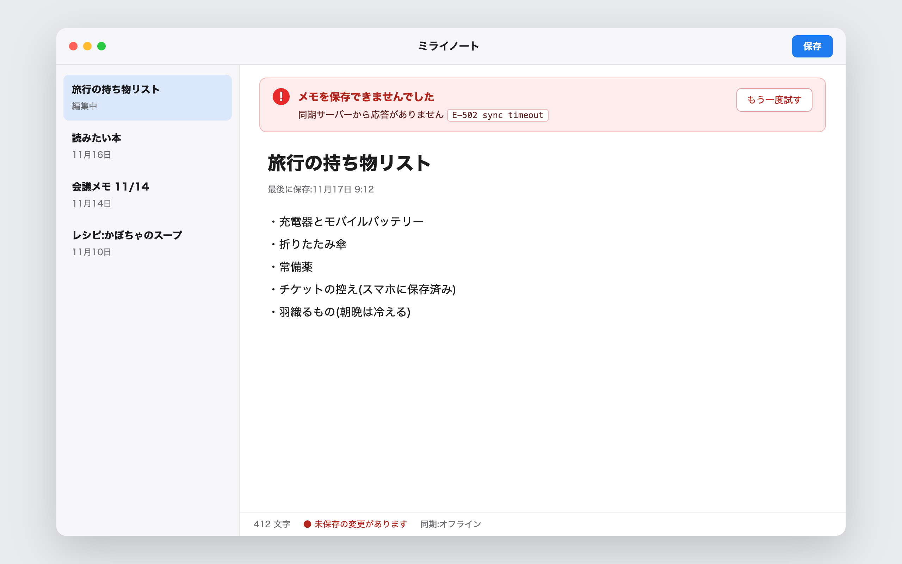
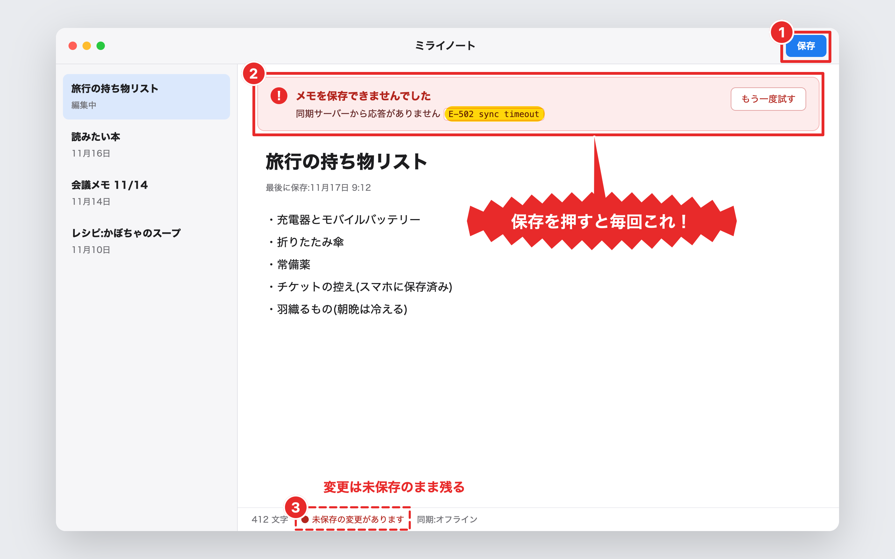

# エラーの画面に、バグ報告の印を付ける

エラーが出た画面に、再現の順番・エラーの文・エラーコード・その後の状態を書き入れた例。Issue やチャットにそのまま貼れる。

| 元の画像 | 書き入れた後 |
|---|---|
|  |  |

## 頼んだこと

```text
~/Desktop/bug.png をバグ報告に使いたい。保存ボタンを押すとエラーが出ることを、
番号付きで書き入れて。エラーコードは目立たせて、叫びの吹き出しも付けて。
変更が未保存のまま残ることも示して
```

## AI がしたこと

1. `get_image_info` で画像(2560×1600 px)を見て、押した所・出たエラー・その後の状態を見つける
2. ① 保存ボタン、② エラーの帯を赤枠で囲み、③ 下の「未保存の変更があります」を点線で囲む
3. エラーコード `E-502 sync timeout` に黄色の蛍光ペンを引き、叫びの吹き出し(`shape: "shout"`)で「保存を押すと毎回これ!」と書く
4. プレビューを見ると、蛍光ペンが左の「ません」に少しかかり、③ の説明文が「同期:オフライン」を隠していた。蛍光ペンを短くし、説明文を上に移して書き直す

付けた注釈は [annotations.json](annotations.json) にある。

## CLI で同じものを作る

```bash
kakiire annotate before.png -o after.png -o after.kakiire -a annotations.json
```

## 元の画面について

[screens/bug.html](../screens/bug.html) は、架空のメモアプリ「ミライノート」で保存に失敗した場面。撮り直すときは `../screens/shoot.sh ../screens/bug.html before.png` を実行する。
