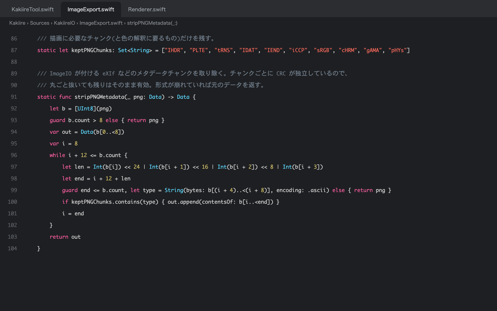
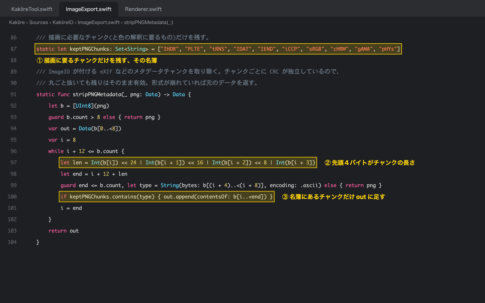

# コードの大事な所に、印と説明を書き入れる

エディタのスクショで、関数の要になる3行を枠で囲み、それぞれに一言の説明を付けた例。コードは Kakiire 本体の [`ImageExport.stripPNGMetadata`](../../../Sources/KakiireIO/ImageExport.swift)(PNG から Exif などのメタデータを取り除く処理)。

| 元の画像 | 書き入れた後 |
|---|---|
|  |  |

## 頼んだこと

```text
~/Desktop/code.png の stripPNGMetadata で、大事な3行に蛍光ペンを引いて、
それぞれ一言で説明して
```

## AI がしたこと

1. `get_image_info` で画像を見て、処理の要になる3行を選ぶ
   - ① 残すチャンクの一覧 `keptPNGChunks`
   - ② チャンクの先頭4バイトから長さを読む行
   - ③ 一覧にあるチャンクだけを `out` に足す行
2. 最初に蛍光ペン(`highlighter`)を試すと、背景が暗いのでほとんど見えなかった。蛍光ペンは乗算で重ねるので、暗い色の上では色が出ない
3. 半透明の黄色で塗った枠(`rect` の `fill`)に替える。説明の文は、行の右の空いた所と、① は下の空いた行に置く

付けた注釈は [annotations.json](annotations.json) にある。

## CLI で同じものを作る

```bash
kakiire annotate before.png -o after.png -o after.kakiire -a annotations.json
```

## 元の画面について

[screens/code.html](../screens/code.html) は、Kakiire 本体のコードをエディタ風に表示したもの。行番号は実際のファイルに合わせている。撮り直すときは `../screens/shoot.sh ../screens/code.html before.png` を実行する。
