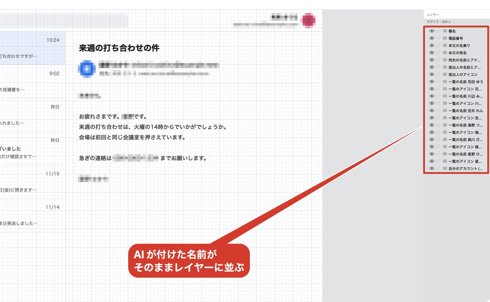

# AI が付けた注釈を、アプリで1つずつ直す

AI に `.kakiire` で書き出してもらうと、付けた注釈がアプリでレイヤーとして並ぶ。AI が付けた名前(「電話番号」「一覧の名前 花田 ゆう」など)がそのままレイヤー名になるので、どれがどこを隠しているかが分かり、隠し漏れや隠しすぎを1つずつ直せる。



元の画面は、[メール画面の個人情報を隠す例](../mail-privacy/README.md)の `after.kakiire` を Kakiire 0.11.0 で開いたもの([before.png](before.png))。右側を切り抜き、レイヤーの一覧を囲んでいる。

## 流れ

1. AI に「PNG と .kakiire で書き出して」と頼む。`annotate_image` の `output` に、2つのパスを配列で渡せば一度に書き出せる
2. 注釈には `name` を付けてもらう。省くと「obscure」のような種類の名前だけが並び、どれがどこか分からない
3. `.kakiire` をアプリで開き、レイヤーの一覧から選んで動かす・消す・足す。目のアイコンで、一時的に隠して確かめることもできる
4. 直したら、アプリから PNG に書き出す。元の画像は `.kakiire` の中に残っているので、何度でもやり直せる

## この画像に付けた注釈

アプリの画面のスクショに、Kakiire の MCP で枠と吹き出しを付けた。付けた注釈は [annotations.json](annotations.json) にある。

```bash
kakiire annotate before.png -o after.png -o after.kakiire -a annotations.json --crop 860,0,1620,1002
```
