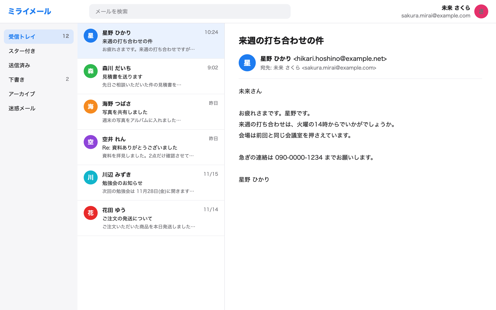
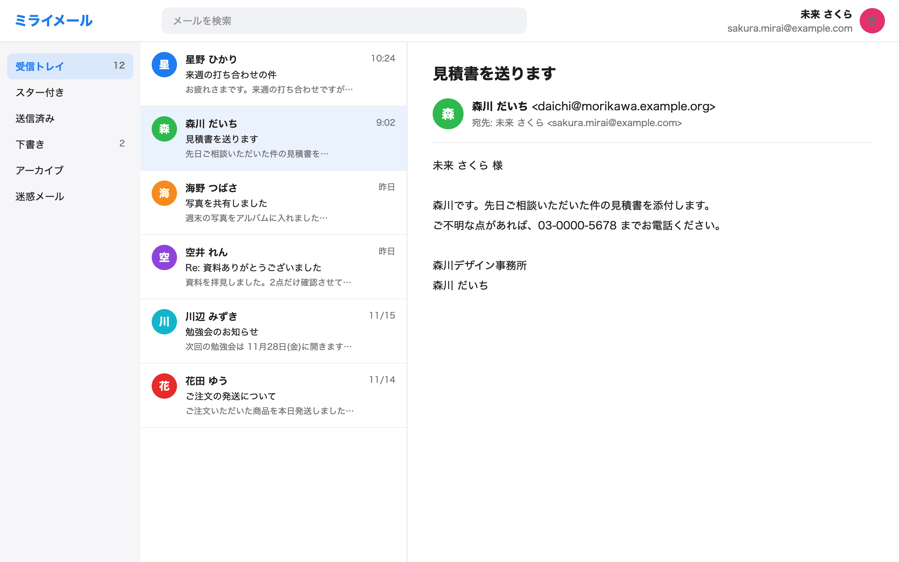
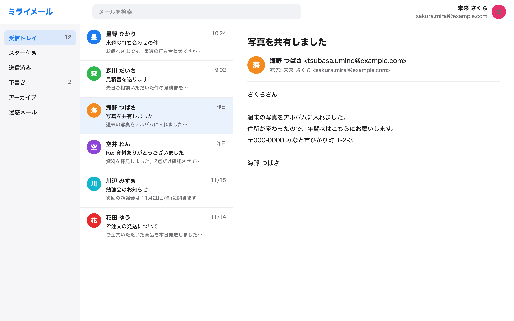

# フォルダのスクショを、まとめて隠して縮める

メール画面のスクショ3枚から、自分のメールアドレスを隠し、半分の大きさにして書き出した例。ブログや資料に何枚も貼るときを想定している。

| | 元の画像(2560×1600) | 書き出した画像(1280×800) |
|---|---|---|
| 1 |  |  |
| 2 |  |  |
| 3 |  |  |

## 頼んだこと

```text
screenshots フォルダのスクショ全部で、自分のメールアドレス(sakura.mirai@example.com)を隠して、
半分の大きさで out フォルダに書き出して
```

## AI がしたこと

1. `get_image_info` で1枚目を見て、右上のアカウント欄にアドレスがあることを確かめる
2. 3枚とも同じ画面なので、同じ位置に `obscure` を付け、`scale: 0.5` で `annotate_image` を3回呼ぶ
3. 最初は `out` フォルダがなく、書き出せなかった。フォルダを作ってやり直す(`annotate_image` は書き出し先のフォルダを作らない)
4. プレビューを見ると、開いているメールの「宛先」にも自分のアドレスが出ていた。宛先にも `obscure` を足して、3枚とも書き出し直す

モザイクの座標は元画像(2560×1600)のピクセルで書き、`scale` で縮めると線やモザイクも一緒に縮む。付けた注釈は [annotations.json](annotations.json) にある。

## CLI で同じものを作る

同じ注釈を何枚にも付けるなら、AI に頼まずにシェルで回してもよい。

```bash
mkdir -p out
for f in screenshots/*.png; do
  kakiire annotate "$f" -o "out/$(basename "$f")" -a annotations.json --scale 0.5
done
```

## 元の画面について

[screens/mail.html](../screens/mail.html) の `#1`・`#2`・`#3` で、開いているメールを変えて撮っている。撮り直すときは次を実行する:

```bash
for i in 1 2 3; do ../screens/shoot.sh ../screens/mail.html screenshots/mail-$i.png "#$i"; done
```
