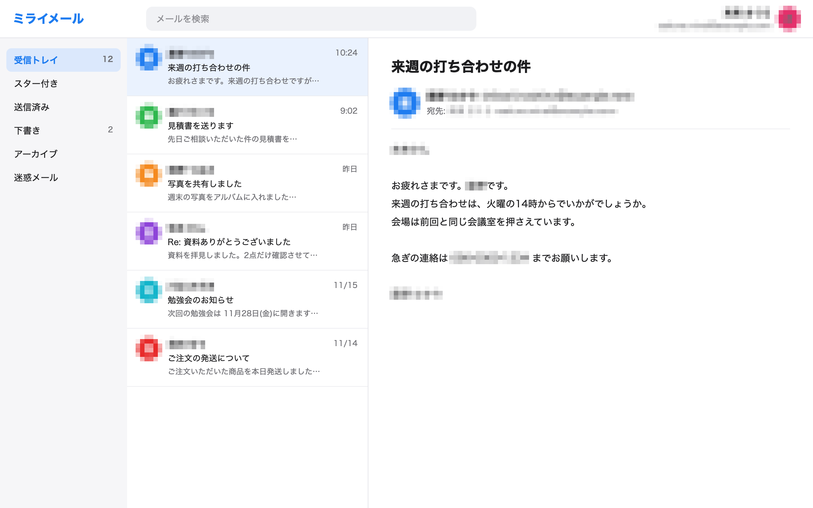

# メール画面の個人情報を、ひと言で隠す

人の名前・メールアドレス・電話番号を、一覧・差出人・宛先・本文・署名から探して、20か所を隠した例。名前の頭文字が入ったアイコンも隠している。

| 元の画像 | 隠した後 |
|---|---|
|  |  |

## 頼んだこと

```text
~/Desktop/mail.png の、人の名前・メールアドレス・電話番号を全部モザイクにして。
名前の入ったアイコンも隠して。PNG と .kakiire で書き出して
```

## AI がしたこと

1. `get_image_info` で画像(2560×1600 px)を見て、隠す場所を見つける
   - 右上の自分のアカウント(名前・アドレス・アイコン)1か所
   - 一覧の6通それぞれのアイコンと名前 12か所
   - 開いているメールの差出人のアイコン、差出人の名前とアドレス、宛先の名前とアドレス
   - 本文の宛名、本文の名乗り(「星野です」の「星野」だけ)、電話番号、署名
2. `annotate_image` で `obscure` を20個付けて書き出す
3. `preview_region` で本文を拡大して見ると、電話番号のモザイクが左にずれ、末尾の「4」が見えていた。電話番号と名乗りの枠を直して書き出し直す

件名・本文のほかの文は残しているので、どんなメールかは読み取れる。付けた注釈は [annotations.json](annotations.json) にある。

## 手で直す

[after.kakiire](after.kakiire) をアプリで開くと、20個のモザイクが「一覧の名前 星野 ひかり」「電話番号」などの名前で並ぶ。隠し漏れや隠しすぎを1つずつ直せる。

## CLI で同じものを作る

```bash
kakiire annotate before.png -o after.png -o after.kakiire -a annotations.json
```

## 元の画面について

[screens/mail.html](../screens/mail.html) は、架空のメールアプリ「ミライメール」。人名・アドレス(`example.com` などの例示用ドメイン)・電話番号・住所はすべて作りもの。撮り直すときは `../screens/shoot.sh ../screens/mail.html before.png '#1'` を実行する。
