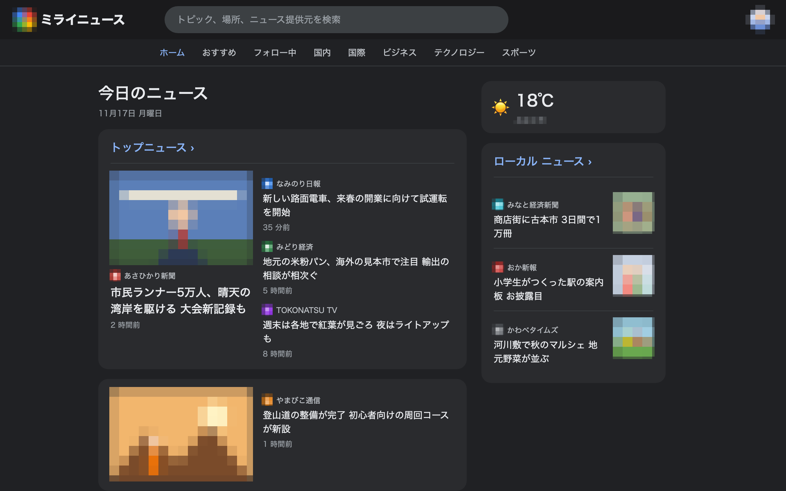

# ニュースサイトのスクショに、まとめてモザイクをかける

記事の写真だけでなく、サイトのロゴ、媒体の小さなアイコン、アカウントのアイコン、天気欄の地名まで、16か所をひと言で隠した例。手で1つずつ囲むと手間のかかる小さなアイコンも、AI が画面から見つけて位置を決める。

| 元の画像 | モザイクをかけた後 |
|---|---|
|  |  |

## 頼んだこと

Claude Code に Kakiire の MCP サーバーを登録して([docs/cli.md](../../cli.md#mcp-サーバー))、こう頼んだ:

```text
~/Desktop/news.png の記事の写真、サイトのロゴ、媒体のアイコン、
右上のアカウントのアイコン、天気の地名に全部モザイクをかけて。
PNG と .kakiire で書き出して
```

## AI がしたこと

1. `get_image_info` で画像の大きさ(2560×1600 px、Retina の 2 倍)と中身を見る
2. 隠す場所を見つけて、元画像のピクセル座標で `obscure`(モザイク)を16個作る
   - 記事の写真 5枚
   - 媒体のアイコン 8個
   - サイトのロゴ、アカウントのアイコン、天気の地名 各1つ
3. `annotate_image` で `after.png` と `after.kakiire` を一度に書き出す
4. 返ってきたプレビューを見て、写真のモザイクが粗さ不足(人の形が読める)だったので、写真だけ強さを 20 から 32 に上げて書き直す

付けた注釈は [annotations.json](annotations.json) にある。写真は強さ 32、小さなアイコンと文字は 12 にしている。

## 手で直す

[after.kakiire](after.kakiire) を Kakiire で開くと、16個のモザイクがレイヤーとして並ぶ(名前は「記事の写真 1」「媒体アイコン おか新報」など)。隠し漏れがあればモザイクを足し、隠しすぎなら消せる。元画像は残ったままなので、何度でもやり直せる。

## CLI で同じものを作る

```bash
kakiire annotate before.png -o after.png -o after.kakiire -a annotations.json
```

## 元の画面について

[page.html](page.html) は、この例のために作った架空のニュースサイト。サイト名・媒体名・記事・写真はすべて作りもので、実在のものとは関係ない。撮り直すときは Chrome で 2 倍にして撮る:

```bash
"/Applications/Google Chrome.app/Contents/MacOS/Google Chrome" --headless=new --hide-scrollbars \
  --force-device-scale-factor=2 --window-size=1280,800 \
  --screenshot="$PWD/before.png" "file://$PWD/page.html"
```
