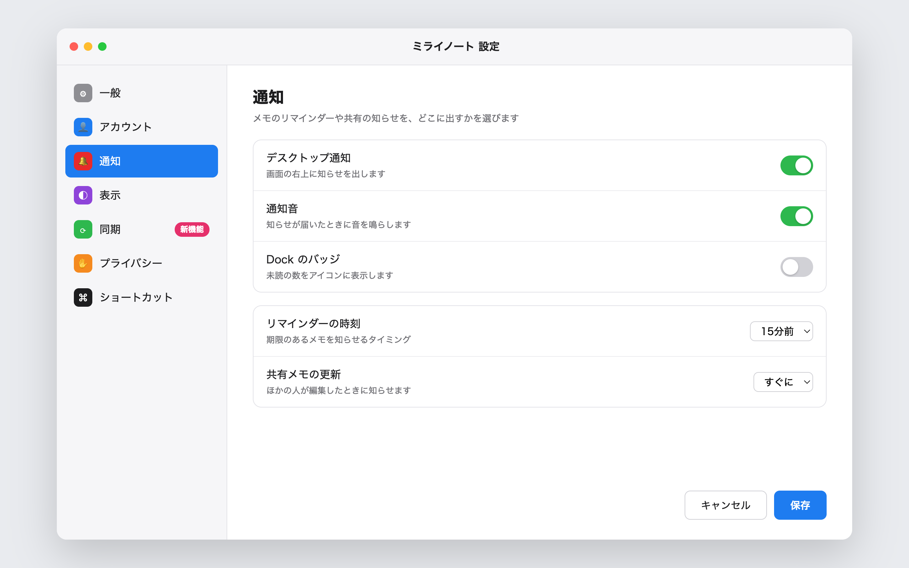
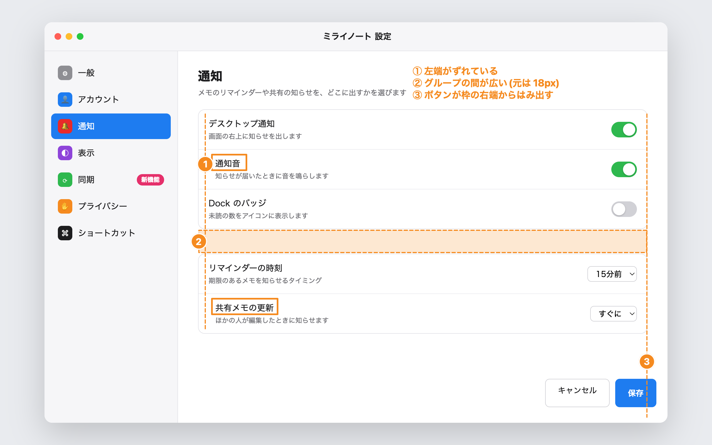

# PR の画面に、レビューの指摘を書き入れる

UI を変えた PR のスクショに、崩れている所を番号と基準線で示した例。レビューのコメントに貼る想定。

| 変更前(main) | PR の画面に書き入れた後 |
|---|---|
|  |  |

元の画像は [before.png](before.png)(PR の画面)。

## 頼んだこと

```text
~/Desktop/pr.png は PR で変えた設定画面。main の ~/Desktop/main.png と比べて、
レイアウトが崩れている所をレビューの指摘として書き入れて。オレンジで
```

## AI がしたこと

1. `get_image_info` で2枚を見比べ、崩れている所を3つ見つける
   - ① 「通知音」と「共有メモの更新」だけ、左端が右にずれている
   - ② 2つのグループの間が広くなっている
   - ③ ボタンの右端が、グループの枠の右端からはみ出している
2. ① と ③ は、そろえるべき端に点線の基準線を引く。② は間のすき間を半透明の塗りで示す
3. 指摘の文は、右上の空いた所にまとめて書く(番号のスタンプと対応させる)
4. プレビューを拡大すると、左の基準線が文字の頭に重なって読みにくく、① の枠が説明文にかかっていた。基準線を 12px 左に寄せ、枠の高さを詰めて書き直す

付けた注釈は [annotations.json](annotations.json) にある。

## CLI で同じものを作る

```bash
kakiire annotate before.png -o after.png -o after.kakiire -a annotations.json
```

## 元の画面について

[screens/settings.html](../screens/settings.html) を `#draft` 付きで開くと、レイアウトが崩れた版になる。撮り直すときは `../screens/shoot.sh ../screens/settings.html before.png '#draft'` を実行する。
