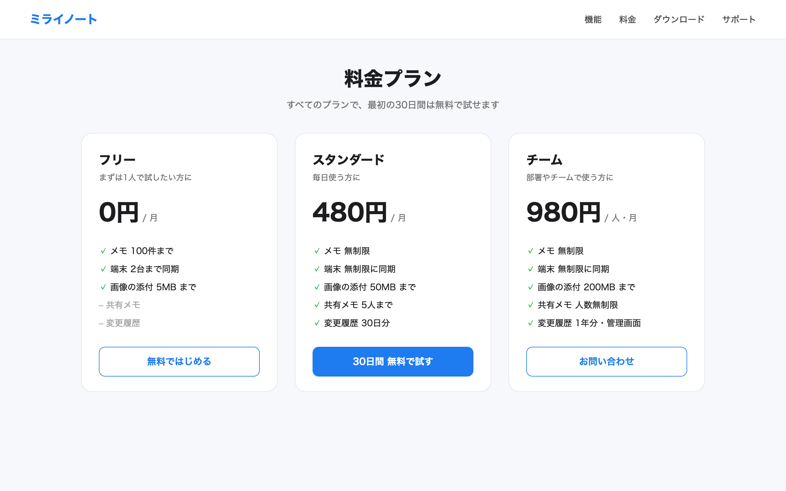
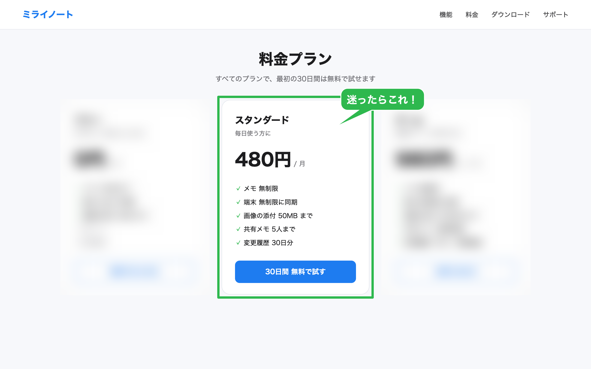

# 料金表で、おすすめのプランに目を向けさせる

3つのプランのうち、おすすめを緑の枠と吹き出しで示し、ほかのプランをぼかした例。モザイクではなくぼかし(`blur`)を使っている。

| 元の画像 | 書き入れた後 |
|---|---|
|  |  |

## 頼んだこと

```text
~/Desktop/pricing.png で、おすすめのスタンダードを緑の枠で囲んで「迷ったらこれ!」と付けて。
ほかのプランはぼかして
```

## AI がしたこと

1. `get_image_info` で画像を見て、3つのプランのカードの範囲を見つける
2. フリーとチームのカードに、ぼかし(`obscure` の `mode: "blur"`)をかける。隠すためではなく目立たせないためなので、形が分かる程度の強さ(24)にする
3. スタンダードのカードを緑の枠で囲み、吹き出しをカードの右上の角に置く。吹き出しは、ぼかした隣のカードに少しはみ出す位置にして、スタンダードの中身を隠さないようにする

付けた注釈は [annotations.json](annotations.json) にある。

## CLI で同じものを作る

```bash
kakiire annotate before.png -o after.png -o after.kakiire -a annotations.json
```

## 元の画面について

[screens/pricing.html](../screens/pricing.html) は、架空のサービス「ミライノート」の料金表。撮り直すときは `../screens/shoot.sh ../screens/pricing.html before.png` を実行する。
