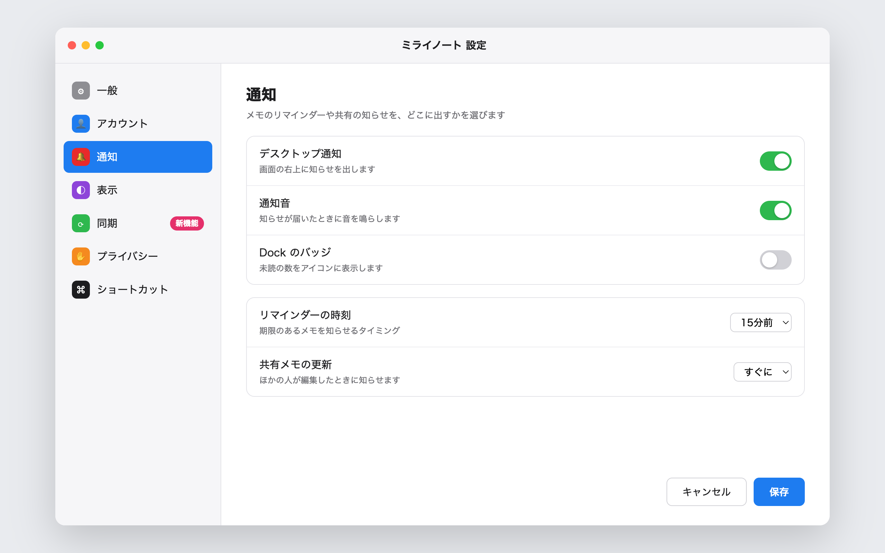
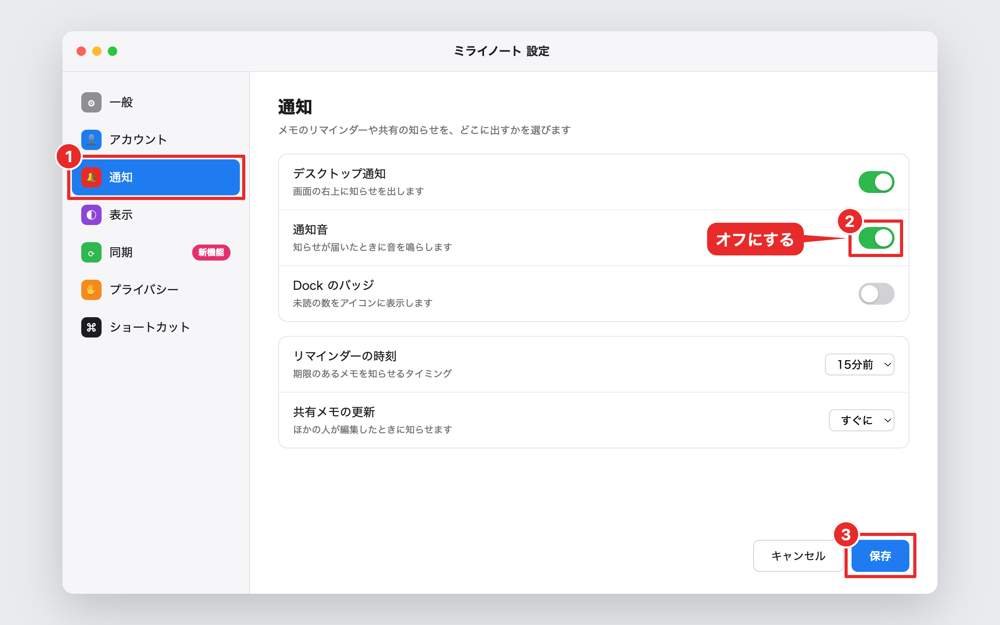

# 設定画面に、操作の手順を番号で書き入れる

「どこを、どの順に押すか」を、番号・枠・吹き出しで示した手順書の例。

| 元の画像 | 書き入れた後 |
|---|---|
|  |  |

## 頼んだこと

```text
~/Desktop/settings.png に、通知音を止める手順を ①②③ の番号で書き入れて。
押す場所は赤枠で囲んで、スイッチには「オフにする」と吹き出しを付けて。
PNG と .kakiire で書き出して
```

## AI がしたこと

1. `get_image_info` で画像(2560×1600 px)を見て、`suggested` から枠の太さ 8・番号の直径 72 を選ぶ
2. 手順を3つに分けて、押す場所を赤枠で囲む
   - ① サイドバーの「通知」
   - ② 「通知音」のスイッチ(吹き出し「オフにする」を左に置く)
   - ③ 「保存」ボタン
3. 番号のスタンプを、それぞれの枠の左上の角に重ねる
4. `annotate_image` で `after.png` と `after.kakiire` を書き出し、プレビューで枠のずれがないことを確かめる

付けた注釈は [annotations.json](annotations.json) にある。

## 手で直す

[after.kakiire](after.kakiire) をアプリで開けば、手順を足したとき番号を振り直したり、枠を動かしたりできる。

## CLI で同じものを作る

```bash
kakiire annotate before.png -o after.png -o after.kakiire -a annotations.json
```

## 元の画面について

[screens/settings.html](../screens/settings.html) は、架空のメモアプリ「ミライノート」の設定画面。撮り直すときは `../screens/shoot.sh ../screens/settings.html before.png` を実行する。
