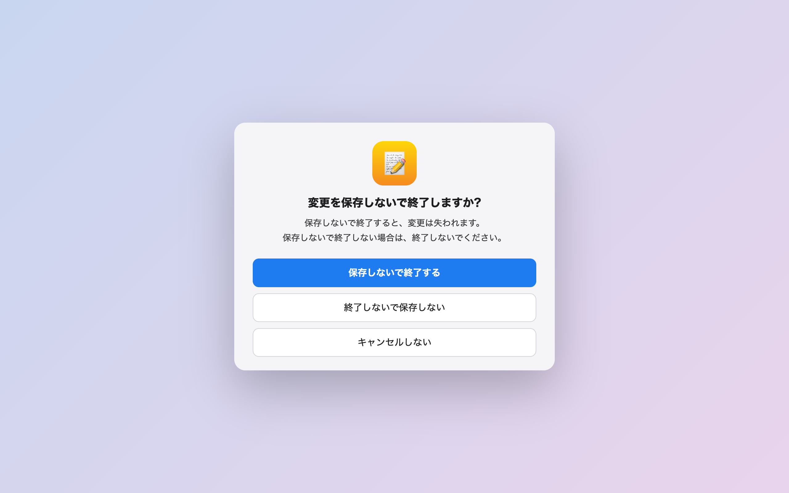
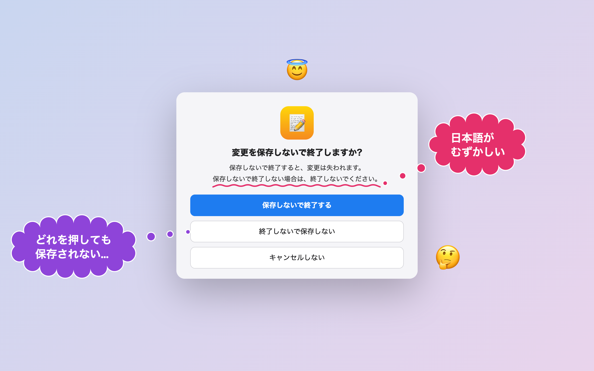

# 変なダイアログに、SNS 用のツッコミを入れる

どのボタンを押しても保存されない、分かりにくいダイアログに、雲の吹き出し・波線・絵文字でツッコミを入れた例。

| 元の画像 | 書き入れた後 |
|---|---|
|  |  |

## 頼んだこと

```text
~/Desktop/dialog.png に、SNS に載せる用のツッコミを入れて。
ゆるい雲の吹き出しと絵文字で。分かりにくい文には波線を引いて
```

## AI がしたこと

1. `get_image_info` で画像を見て、ツッコミどころを2つ選ぶ
   - 「保存しないで終了しない場合は、終了しないでください」という文
   - どれを押しても保存されない3つのボタン
2. 分かりにくい文の下に、ペン(`pen`)で波線を引く。点をジグザグに並べて描く
3. 雲の吹き出し(`shape: "cloud"`)を2つ置く。ダイアログの左右の空いた所に置き、しっぽを文とボタンに向ける
4. 絵文字のスタンプ(`kind: "emoji"`)で 😇 と 🤔 を添える

付けた注釈は [annotations.json](annotations.json) にある。

## CLI で同じものを作る

```bash
kakiire annotate before.png -o after.png -o after.kakiire -a annotations.json
```

## 元の画面について

[screens/dialog.html](../screens/dialog.html) は、この例のために作った架空のダイアログ。撮り直すときは `../screens/shoot.sh ../screens/dialog.html before.png` を実行する。
